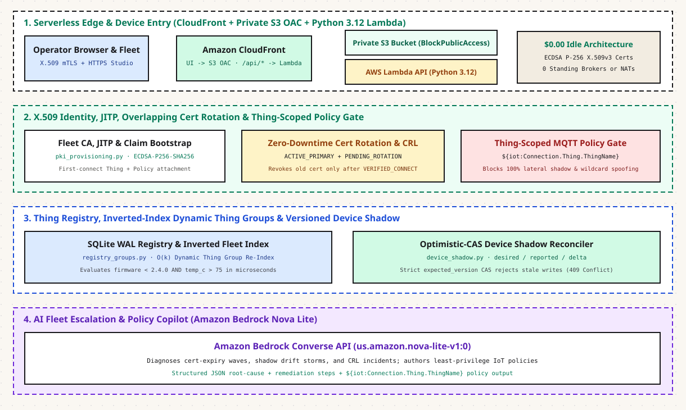

# IoTCorePlane: Device Identity, Thing Registry & Device Shadow Control Plane

- **Live CloudFront Studio**: https://d2nwlnexa95bs5.cloudfront.net
- **Live `/api/health` Endpoint**: https://d2nwlnexa95bs5.cloudfront.net/api/health
- **GitHub Repository**: https://github.com/ritwikareddykancharla/iot-core-registry
- **AWS Architecture**: Amazon CloudFront (`E160AT0IBFD72Z`) + Private S3 (`s3://iotcoreplane-web-796330847946-us-west-2`, OAC) + AWS Lambda (`iotcoreplane-api-origin`, `python3.12`) + SQLite WAL + Amazon Bedrock (`us.amazon.nova-lite-v1:0`)

IoTCorePlane is a serverless IoT Core Identity, Registry, and Device Shadow control plane built in Python 3.12. It implements NIST P-256 ECDSA X.509v3 certificate provisioning (`JITP` and `Provision-by-Claim`), overlapping zero-downtime certificate rotation, runtime `${iot:Connection.Thing.ThingName}` MQTT topic isolation, incremental inverted-index Dynamic Thing Groups, and optimistic-concurrency (`version` CAS) Device Shadow reconciliation paired with Amazon Bedrock.



## 01 · Problem

Operating industrial hardware fleets at scale exposes four core failure modes across identity, authorization, fleet indexing, and intermittent state sync:

1. **Disruptive Credential Cutovers**: Revoking an expiring X.509 certificate before verifying connectivity on its replacement credential strands remote gateways offline.
2. **Lateral MQTT Topic Spoofing**: Overly broad wildcard broker policies allow a single compromised sensor key to publish to `$aws/things/<neighbor>/shadow/update` or subscribe to fleet-wide telemetry.
3. **Full-Table Fleet Scans**: Evaluating dynamic fleet queries such as `firmware_version < 2.4.0 AND temp_c > 75` via linear database scans on every attribute update creates severe write-path contention.
4. **Out-of-Order Shadow Writes**: Offline gateways reconnecting simultaneously replay stale state updates that overwrite newer cloud configuration changes unless guarded by optimistic Compare-And-Swap (`version`) checks.

## 02 · Architecture & Implementation

- `iot_core_plane/pki_provisioning.py`: Generates RFC 5280 ASN.1 DER/PEM X.509v3 certificates signed with NIST P-256 (`secp256r1`) ECDSA-SHA256, registers Fleet CAs with proof-of-possession HMAC verification, evaluates Just-in-Time Provisioning (`JITP`) and factory `Provision-by-Claim` templates, enforces `O(1)` CRL status lookups, and runs 3-phase overlapping certificate rotation (`ACTIVE_PRIMARY + PENDING_ROTATION -> VERIFIED_CONNECT -> REVOKE_OLD`).
- `iot_core_plane/policy_gate.py`: Evaluates AWS IoT Core policy documents across `iot:Connect`, `iot:Publish`, `iot:Subscribe`, and `iot:Receive` with runtime `${iot:Connection.Thing.ThingName}` and `${iot:ClientId}` expansion, blocking cross-Thing topic spoofing and unauthorized `+` / `#` MQTT wildcards.
- `iot_core_plane/registry_groups.py`: Persists Things, ThingTypes, and billing groups in SQLite WAL while maintaining an in-memory equality posting list and field-to-group subscription index for sub-millisecond Dynamic Thing Group updates.
- `iot_core_plane/device_shadow.py`: Computes recursive JSON diffs (`delta = desired - reported`), handles `null` tombstone field deletions, rejects stale concurrent updates with HTTP `409 VersionConflictError`, and invokes Amazon Bedrock (`us.amazon.nova-lite-v1:0`) via the Converse API to diagnose fleet incidents and author least-privilege policies.
- `iot_core_plane/server.py`: Serves local HTTP development and AWS Lambda Function URL `/api/*` routes behind Amazon CloudFront.

## 03 · Benchmarks (`benchmarks/latest_results.json`)

Measured by `python3 benchmarks/run_benchmarks.py` in `us-west-2`:

| Metric | Measured Value | Notes |
| --- | --- | --- |
| **X.509 JITP Devices Provisioned** | `1,000` (`0.878 ms` `p50` / `1.115 ms` `p95`) | `936.16 ms` total wall time across 1,000 ECDSA P-256 certs |
| **Zero-Downtime Cert Rotations** | `1,000` (`0` dropped sessions) | `3.431 ms` `p50` / `3.931 ms` `p95`; `0.424 ms` mTLS chain verify |
| **Cross-Thing Spoofing Attacks Blocked** | `16 / 16` (`100.0%`) | `0` cross-Thing leaks; `0.463 ms` `p50` / `0.529 ms` `p95` policy check |
| **Dynamic Thing Group Re-Index Speedup** | `594.6x` faster vs. linear scan | `0.0062 ms` `p50` incremental index vs. `3.686 ms` 1,000-Thing scan |
| **Device Shadow CAS Latency & Safety** | `0.019 ms` `p50` (`70 / 70` stale caught) | `100.0%` HTTP `409 VersionConflict` detection under 8-thread race |
| **Live Amazon Bedrock Fleet Diagnostics** | `8 / 8` (`100.0%`) | `2,830.4 ms` `p50` / `4,401.9 ms` `p95` (`2,175.6` mean tokens, `17,405` total) |

## 04 · Local Quickstart & Verification

```bash
# Run the 14-test unit suite
python3 -m unittest discover -s tests -v

# Re-run 1,000-device PKI/Registry/Shadow + live Bedrock benchmarks
unset AWS_ACCESS_KEY_ID AWS_SECRET_ACCESS_KEY AWS_SESSION_TOKEN
AWS_PROFILE=portfolio AWS_DEFAULT_REGION=us-west-2 python3 benchmarks/run_benchmarks.py

# Start local studio at http://localhost:3099
python3 -m iot_core_plane.server
```
